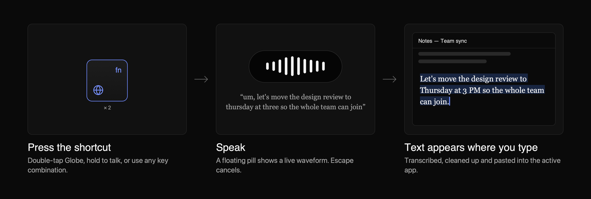
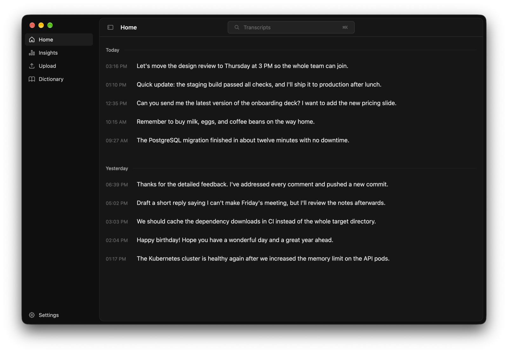
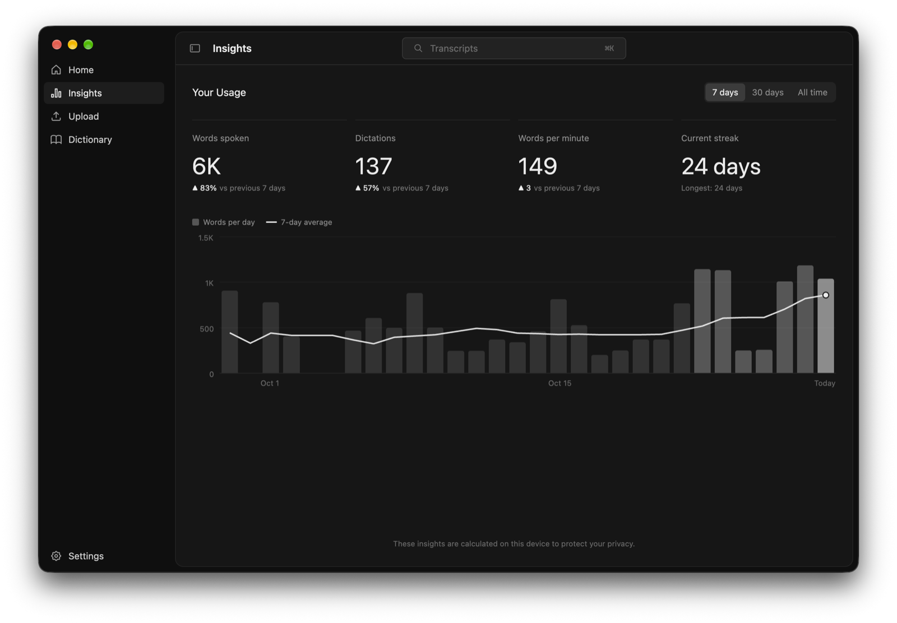
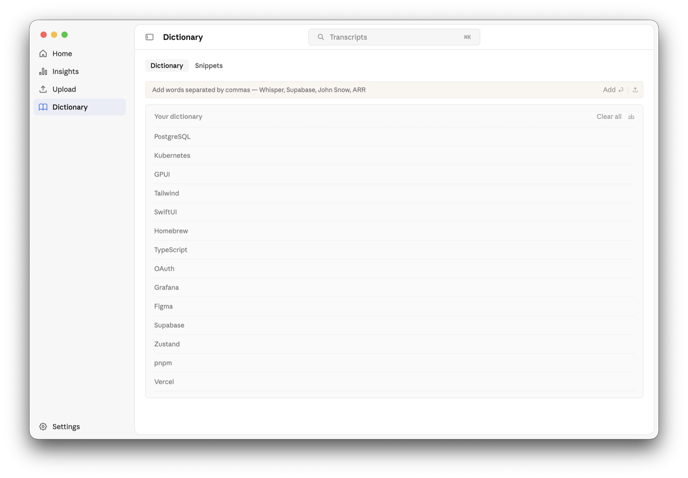
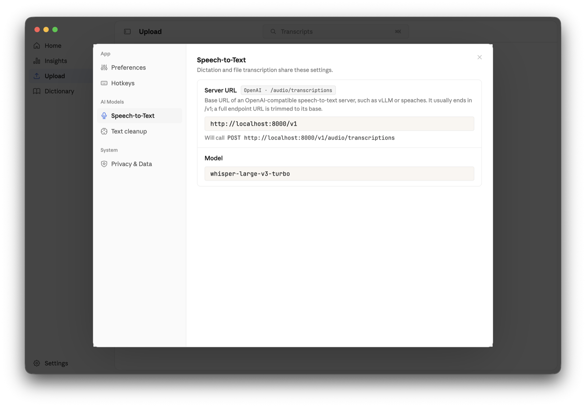

# Whisper

English | [简体中文](README.zh-CN.md)

A native macOS dictation app built with Rust and [GPUI](https://www.gpui.rs).
Press a shortcut, speak, and Whisper transcribes your voice with your own
OpenAI-compatible speech server, optionally cleans up the text with a
chat-completions model, and pastes the result into whatever app you are
typing in.



## Features

- **Dictate anywhere.** Trigger with Globe/Fn, a single modifier such as Right
  Command, or any key combination. Double-tap for hands-free recording or hold
  to talk. A floating recording pill shows a live waveform and offers cancel and a
  command menu; Escape cancels.
- **Self-hosted models.** Speech recognition goes to your own
  `/audio/transcriptions` endpoint; optional cleanup goes to a
  `/chat/completions` endpoint, with an editable prompt and a Prompt Studio to
  test it.
- **Gets better with use.** A dictionary supplies spelling hints, corrections
  you make right after a paste are learned, and Snippets expand short phrases
  into longer text.
- **History.** Search with Cmd+K, view raw transcripts, retry from saved audio,
  review failed or discarded entries, and set how long audio and transcripts
  are kept.
- **File transcription.** Transcribe a single audio or video file, or a batch.
- **Insights.** Words spoken, dictation count, words per minute, streaks and
  a six-month activity heatmap, all computed on device.
- **Fits into macOS.** Menu bar icon, standard app menu, start at login,
  pauses media while recording, English and Simplified Chinese UI, and light,
  dark or automatic themes.

Data lives in `~/Library/Application Support/com.softmaxe.whisper`.

## Screenshots

The screenshots use sample data.

| History | Insights |
| --- | --- |
|  |  |
| **Dictionary** | **Speech-to-text settings** |
|  |  |

## Install

```sh
brew install --cask softmaxe/tap/whisper
```

Releases are also published on the
[Releases page](https://github.com/softmaxe/whisper/releases/latest) as a
zipped app with a SHA-256 checksum. The app is signed with a persistent
self-signed certificate, not notarized, so macOS may ask you to confirm the
first launch in System Settings > Privacy & Security.

## Performance compared with the Electron version

The app was previously built with Electron and React. Moving to Rust and GPUI
made it faster to start, much lighter on memory and CPU, and a fraction of the
size.

Measured on an Apple M2 Pro (32 GB), comparing the release bundles of both
versions with the same data directory and settings.

| Metric | Rust + GPUI | Electron | Change |
| --- | --- | --- | --- |
| Launch to window on screen | ~390 ms | ~680 ms | 43% faster |
| Launch to first painted content | ~495 ms | ~775 ms | 36% faster |
| Memory, physical footprint (all processes) | 83 MB | 220–236 MB | ~65% less |
| Memory, resident set (all processes) | 154 MB | ~698 MB | ~78% less |
| Processes | 2 | 9 | |
| CPU while recording | 6.1% | 43.6% | ~86% less |
| CPU idle, app hidden | 0.0% | 0.0% | same |
| CPU idle, control panel in front | 1.2–1.4% | 0.1% | higher |
| App bundle size | 64 MB | 319 MB | 80% smaller |
| Files in the bundle | 17 | 344 | |

The Rust bundle's 64 MB includes a 21 MB static `ffmpeg`.

The one regression is idle CPU while the control panel is visible. GPUI keeps
a display link ticking at the screen refresh rate for visible windows, even
though nothing is redrawn. It stops once the window is hidden, minimized,
closed or covered.

How it was measured:
- Launch times are the median of 5 cold launches via `open`, after one
  warm-up. Two polls were timed: the window appearing in `CGWindowList`, and
  the window image showing painted UI.
- Memory comes from `footprint` and `ps`, summed over the app's process tree
  after a 40-second settle.
- CPU comes from `top`, averaged over 30 s idle and 10 s of recording
  (double-tap shortcut, then Escape).
- Each steady-state run was repeated twice per app with matching results.

Transcription latency was not compared: both versions call the same server,
which dominates end-to-end time.

## Requirements

- Apple Silicon Mac, macOS 12 or later
- Rust, pinned in `rust-toolchain.toml`, and the Xcode command line tools
  (`swiftc`, `clang`) for the native helpers that `build.rs` compiles into
  `resources/bin`
- A reachable speech recognition server; a cleanup server is optional

## Build and run

```sh
cargo run                    # debug build
scripts/check.sh             # formatting, clippy and tests, as in CI
scripts/bundle-macos.sh      # release build -> dist/Whisper.app (ad-hoc signed)
```

Bundling ffmpeg (needed to upload non-WAV audio and video) is optional:
`scripts/download-ffmpeg.sh` fetches the pinned static build that releases
ship, and `scripts/fetch-ffmpeg.sh [path-to-ffmpeg]` copies a local one into
`resources/bin`. Run either before the bundle script.

Release signing and publishing are described in
[docs/macos-signing.md](docs/macos-signing.md) and
[docs/testing.md](docs/testing.md).

The app asks for Microphone access when you first dictate and needs
Accessibility access for automatic paste and the Globe/modifier listeners.

## Environment variables

| Variable | Purpose |
| --- | --- |
| `WHISPER_USER_DATA_DIR` | Use another data directory (tests, side-by-side runs) |
| `WHISPER_HELPERS_DIR` | Load the native helpers from another directory |
| `RUST_LOG` | Log filter, for example `info,whisper::native=debug` |

## Layout

- `src/`: settings, database, audio capture, transcription and cleanup
  services, text processing, native macOS integrations
- `src/app.rs`, `src/ui/`, `src/dictation.rs`: the GPUI app; `src/main.rs`
  only calls `whisper::run()`
- `resources/native/`: Swift helper sources; `resources/mediaremote-adapter/`:
  vendored MediaRemoteAdapter
- `locales/`: UI strings and cleanup prompts
- `packaging/`, `scripts/`: app bundle metadata, signing and build scripts
- `docs/`: signing, testing and maintenance notes

## License

[GNU Affero General Public License v3.0](LICENSE).
