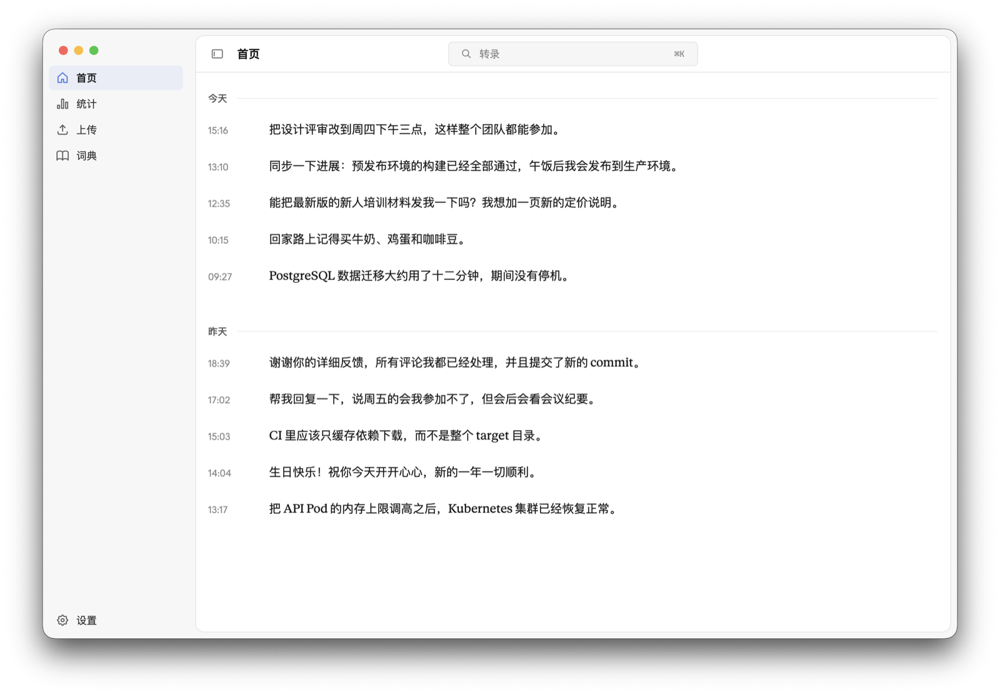
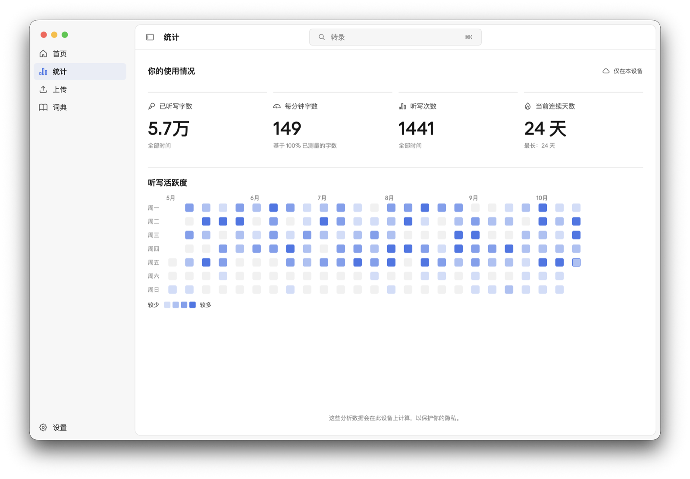
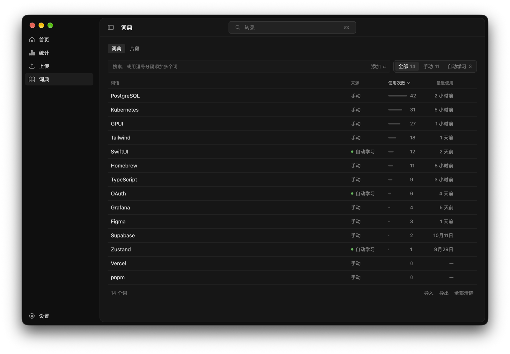
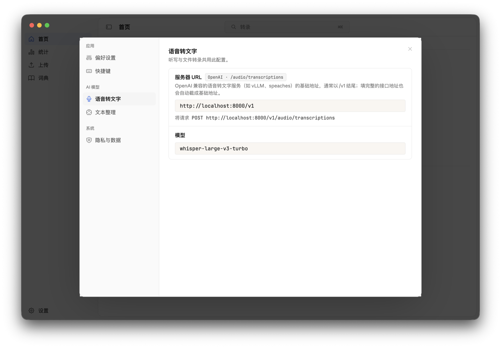
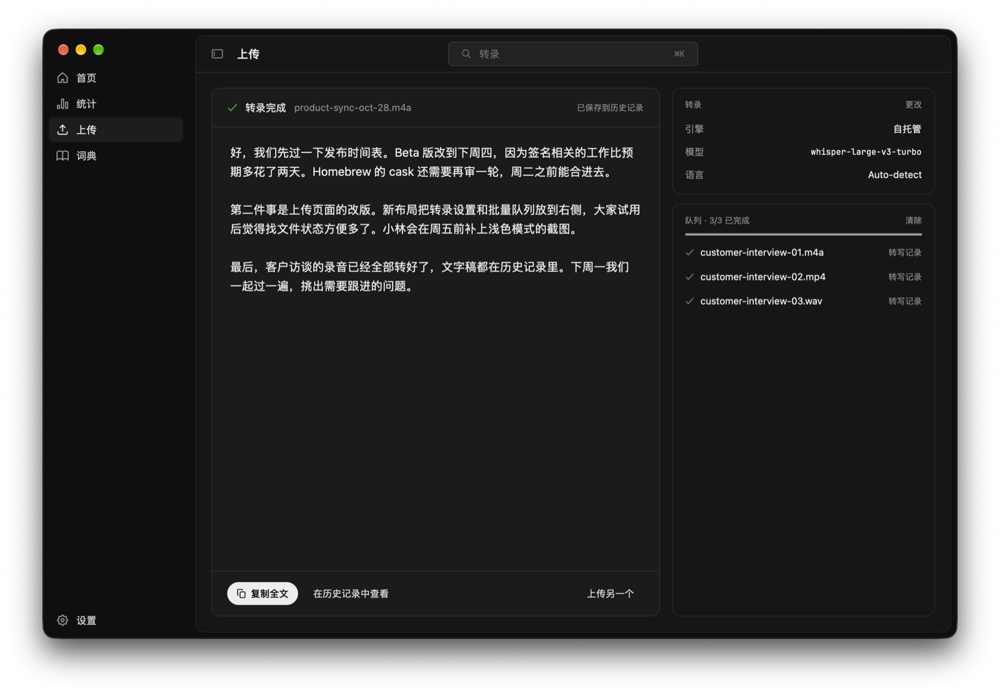

# Whisper

[English](README.md) | 简体中文

一款用 Rust 和 [GPUI](https://www.gpui.rs) 编写的 macOS 原生语音输入应用。
按下快捷键说话，Whisper 会调用你自己的 OpenAI 兼容语音识别服务完成转写，
可选地用 chat-completions 模型整理文字，再把结果粘贴到你正在输入的应用中。


## 功能

- **随处听写。** 可用 Globe/Fn 键、单个修饰键（如右 Command）或任意组合键触发。
  单键双击进入免手持录音（组合键按一次即开始或结束），或按住说话。录音时会出现
  悬浮条，显示实时波形；点击悬浮条结束录音，悬停时可点取消按钮，按 Esc 取消。
- **自托管模型。** 语音识别请求发送到你自己的 `/audio/transcriptions` 接口；可选的
  文字整理请求发送到 `/chat/completions` 接口，提示词可编辑，并可在 Prompt Studio
  中测试。
- **越用越准。** 词典为识别提供拼写提示；粘贴后立即做出的修改会被自动学习；
  片段（Snippets）可以把短语展开为更长的文本。
- **历史记录。** 用 Cmd+K 搜索、查看原始转写、用保存的音频重试，并设置音频和转写的
  保留时长。
- **文件转写。** 可转写单个音频或视频文件，也可批量转写。
- **统计。** 最近 7 天、30 天或全部时间的字数、听写次数、每分钟字数和连续天数，
  每项都与上一周期对比，并附带每日趋势图和 7 日均线，全部在本机计算。
- **融入 macOS。** 菜单栏图标、标准应用菜单、开机启动（macOS 13+）、可选在录音时暂停媒体播放、
  英文和简体中文界面，以及浅色、深色或自动主题。

数据保存在 `~/Library/Application Support/com.softmaxe.whisper`。

## 截图

截图中的数据均为示例数据。

| 历史记录 | 统计 |
| --- | --- |
|  |  |
| **词典** | **语音转文字设置** |
|  |  |
| **文件转录** | |
|  | |

## 安装

```sh
brew install --cask softmaxe/tap/whisper
```

每个版本也会发布在 [Releases 页面](https://github.com/softmaxe/whisper/releases/latest)，
提供压缩后的应用和 SHA-256 校验值。应用使用固定的自签名证书签名，未经过公证，
因此首次启动时 macOS 可能要求你在“系统设置 > 隐私与安全性”中确认。

## 与 Electron 版本的性能对比

应用之前基于 Electron 和 React 构建。迁移到 Rust 和 GPUI 后，启动更快，内存和 CPU
占用大幅降低，体积也只有原来的一小部分。

测试环境为 Apple M2 Pro（32 GB），对比两个版本的发布包，使用相同的数据目录和设置。

| 指标 | Rust + GPUI | Electron | 变化 |
| --- | --- | --- | --- |
| 从启动到窗口出现 | ~390 ms | ~680 ms | 快 43% |
| 从启动到首次绘制内容 | ~495 ms | ~775 ms | 快 36% |
| 内存，物理占用（所有进程） | 83 MB | 220–236 MB | 少约 65% |
| 内存，常驻集（所有进程） | 154 MB | ~698 MB | 少约 78% |
| 进程数 | 2 | 9 | |
| 录音时 CPU | 6.1% | 43.6% | 少约 86% |
| 空闲 CPU，应用隐藏 | 0.0% | 0.0% | 相同 |
| 空闲 CPU，控制面板在前台 | 1.2–1.4% | 0.1% | 更高 |
| 应用包大小 | 95 MB | 319 MB | 小 70% |
| 应用包内文件数 | 19 | 344 | |

Rust 版应用包的 95 MB（0.0.6 实测）中包含一个 43 MB 的静态 `ffmpeg`。

唯一的退步是控制面板可见时的空闲 CPU。GPUI 会让可见窗口的 display link 以屏幕刷新率
持续运行，即使没有任何重绘。窗口被隐藏、最小化、关闭或遮挡后，它就会停止。

测量方法：
- 启动时间取预热一次后，用 `open` 冷启动 5 次的中位数。分别计时两个轮询：窗口出现在
  `CGWindowList` 中，以及窗口图像显示出已绘制的界面。
- 内存来自 `footprint` 和 `ps`，在稳定 40 秒后对应用的进程树求和。
- CPU 来自 `top`，取 30 秒空闲和 10 秒录音（双击快捷键，然后按 Esc）的平均值。
- 每个稳态测试对每个应用重复两次，结果一致。

未对比转写延迟：两个版本调用同一个服务器，端到端耗时主要取决于服务器。

## 环境要求

- Apple Silicon Mac，macOS 12 或更高版本
- Rust（版本固定在 `rust-toolchain.toml` 中），以及 Xcode 命令行工具（`swiftc`、
  `clang`），用于编译 `build.rs` 输出到 `resources/bin` 的原生辅助程序
- 一个可访问的语音识别服务；文字整理服务可选

## 构建与运行

```sh
cargo run                    # debug build
scripts/check.sh             # formatting, clippy and tests, as in CI
scripts/bundle-macos.sh      # release build -> dist/Whisper.app (ad-hoc signed)
```

内置 ffmpeg 是可选的。只有上传视频，或 MP3、WAV、M4A、WebM、Ogg/Opus、FLAC、AAC 以外的音频时才需要；未内置时会使用 Homebrew 或 `PATH` 中的 ffmpeg。
`scripts/download-ffmpeg.sh` 下载发布版使用的固定静态构建，
`scripts/fetch-ffmpeg.sh [path-to-ffmpeg]` 把本地的 ffmpeg 复制到 `resources/bin`。
请在运行打包脚本之前执行其中一个。

发布签名和发布流程见 [docs/macos-signing.md](docs/macos-signing.md) 和
[docs/testing.md](docs/testing.md)。

首次听写时应用会请求麦克风权限；自动粘贴以及 Globe/修饰键监听需要辅助功能权限。

## 环境变量

| 变量 | 用途 |
| --- | --- |
| `WHISPER_USER_DATA_DIR` | 使用其他数据目录（测试、并行运行） |
| `WHISPER_HELPERS_DIR` | 从其他目录加载原生辅助程序 |
| `RUST_LOG` | 日志过滤，例如 `info,whisper::native=debug` |

## 目录结构

- `src/`：设置、数据库、音频采集、转写和整理服务、文本处理、macOS 原生集成
- `src/app.rs`、`src/ui/`、`src/dictation.rs`：GPUI 应用；`src/main.rs` 只调用
  `whisper::run()`
- `resources/native/`：Swift 辅助程序源码；`resources/mediaremote-adapter/`：
  内置的 MediaRemoteAdapter
- `locales/`：界面文案和整理提示词
- `packaging/`、`scripts/`：应用包元数据、签名和构建脚本
- `docs/`：签名、测试和维护说明

## 许可证

[GNU Affero General Public License v3.0](LICENSE)。
